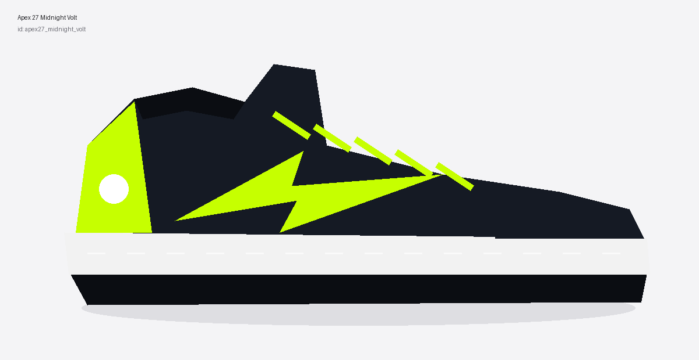
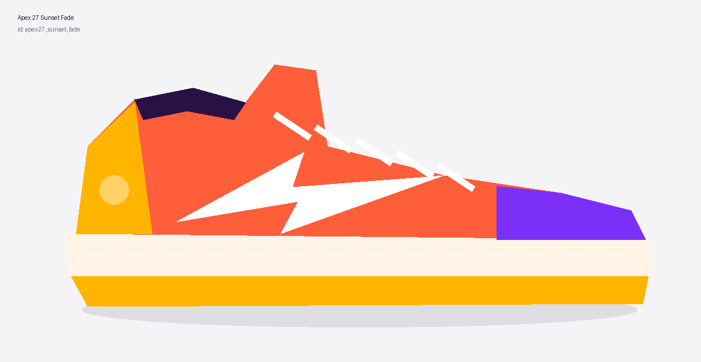
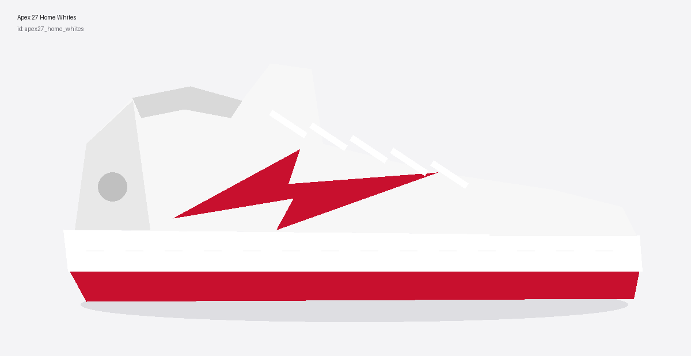

# NBA 2K27 Custom Shoe Mod: Apex 27

This is an original signature-shoe line, the **Apex 27**, for NBA 2K27 on PC. The repo contains:

- **3 colorways** in `colorways/`: Midnight Volt, Sunset Fade, Home Whites
- **`tools/shoe_mod.py`**, which builds the full texture set for each colorway:
  - color/albedo, normal, and specular maps
  - each map as both PNG and DDS (BC3/DXT5)
  - a preview image and a `manifest.json`

| Midnight Volt | Sunset Fade | Home Whites |
|---|---|---|
|  |  |  |

> All designs here are original. Don't add real brand logos or trademarks
> (Nike, Jordan, adidas, etc.) if you plan to share the mod publicly.

## Quick start

```bash
pip install -r tools/requirements.txt
python tools/shoe_mod.py generate colorways/*.json          # 2048x2048 textures
python tools/shoe_mod.py generate colorways/*.json --size 4096
```

The output goes to `build/<shoe_id>/`:

```
apex27_midnight_volt_color.png / .dds    albedo
apex27_midnight_volt_normal.png / .dds   tangent-space normal map
apex27_midnight_volt_spec.png  / .dds    R=specular, G=gloss, B=height
preview.png
manifest.json
```

## Two ways to build

### 1. `generate`: built-in template
This mode paints a complete atlas using the template layout below. Use it when you're
building or UV-mapping your own shoe model, or as a set of material swatches.

```
+-----------------+--------+--------+
|                 |  toe   |  heel  |
|      upper      +--------+--------+
|                 | collar | tongue |
+-----------------+--------+--------+
|     accent      | laces  |  logo  |
+-----------------+--------+--------+
|             midsole               |
+-----------------------------------+
|             outsole               |
+-----------------------------------+
```

### 2. `recolor`: on top of a real in-game shoe (recommended for 2K)
Every shoe model in 2K has its own UV layout. To put a colorway on an existing
in-game shoe:

1. Export that shoe's color texture with your modding tool (see below) as PNG.
2. Make a **mask**: a copy of the texture where each part is painted a flat key color.

   | region | key color | region | key color |
   |---|---|---|---|
   | upper | `#FF0000` | laces | `#00FFFF` |
   | toe | `#00FF00` | midsole | `#FF8000` |
   | heel | `#0000FF` | outsole | `#8000FF` |
   | collar | `#FFFF00` | accent | `#0080FF` |
   | tongue | `#FF00FF` | logo | `#FFFFFF` |

   Leave anything you don't want changed black.
3. Run:
   ```bash
   python tools/shoe_mod.py recolor colorways/sunset_fade.json \
       --texture exported/shoe_color.png --mask exported/shoe_mask.png
   ```
   The original shading, stitching, and wrinkles are kept. Only the color and
   material response change.

## Make your own colorway

Copy any file in `colorways/` and edit it:

```json
{
  "id": "apex27_my_colorway",
  "name": "Apex 27 My Colorway",
  "regions": {
    "upper": { "color": "#ff5e3a", "gradient": "#7b2ff7", "material": "knit" },
    ...
  }
}
```

- All 10 regions are required: `upper toe heel collar tongue laces midsole outsole accent logo`.
- `gradient` is optional and gives a left-to-right fade.
- Available materials: `knit`, `mesh`, `leather`, `suede`, `patent`, `foam`, `rubber`, `metallic`.

## Installing in NBA 2K27 (PC)

2K27 mods are loaded with community tools. The usual workflow is the same as
in previous years:

1. Back up your game folder.
2. Open the game files with the current community modding tool for 2K27. This is
   typically a texture/IFF editor and a mod manager from the 2K modding scene
   (e.g. the NLSC / ModdingWay community).
3. Find the shoe file you want to replace and export its texture. Use `recolor`
   as described above, or import the generated `.dds` files directly.
4. Import the `_color`, `_normal`, and `_spec` textures into the matching slots,
   save the file into the tool's mods folder, and enable the mod.
5. Launch the game **offline**.

> **Use offline modes only** (Play Now offline, MyLEAGUE/MyNBA offline).
> Modded files in online modes (MyCAREER online, MyTEAM, Park/City) can get your
> account banned. Each game patch can also break mods until the tools update.

The exact file names and texture slots depend on the tool version you use. The
`manifest.json` in each build folder lists what was produced.

## Repo layout

```
colorways/        colorway definitions (JSON)
tools/shoe_mod.py texture builder (generate / recolor / preview)
docs/previews/    preview images
build/            generated output (git-ignored)
```
